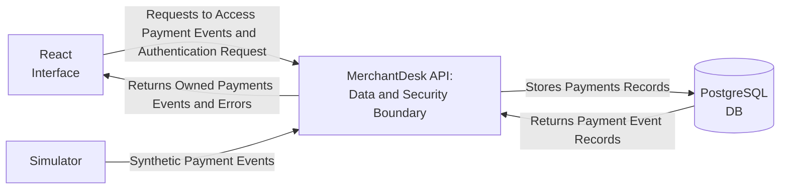

# MerchantDesk Brief

**MerchantDesk is a system which provides a clean and efficient interface for merchants to Monitor, Validate and Record Sandbox payment events.**

- ## The User

  **MerchantDesk will be a go-to place for the Merchant Operators to inspect their owned payment event records without having to worry about any duplicate events. The MerchantDesk API will acts as the data and security boundary which does ownership checks and validates payment records and forwards valid ones to the database to store as well as handles requests and responses from the react interface.The simulator supplies the synthetic payment records to the API.The merchant operator inspects their events from the react interface.**

- ## Useful Actions
  - **The user will be able to submit sandbox payment events to the MerchantDesk API via an authenticated  Simulator.**
  - **The user will be able to  sign in and sign out of  the React Interface using their  credentials.**
  - **The user will be able to inspect owned events, paginate them,filter or sort them.**
- ## What's not included?
  - **Real payment processing.**
  - **Refund or retry logic.**
  - **No Payhook services.**
  - **Exposed webhook endpoints.**
  - **Card/customer data.**
  - **Provider credentials.**
  - **HMAC verification.**
  - **Account registration/reset.**
  - **Production billing.**
  - **Guaranteed exactly-once delivery.**
  - **Polished commercial dashboard.**
  - **Paid services or additional frameworks and techs other than TypeScript/JavaScript,REACT vite,Fastify,PostgreSQL**
- ## Open Questions
  1.  **What additional information besides payment records should be displayed on the React Interface?**
  2.  **Should an operator have access to delete their own events?**
  3.  **Which fields should be used to filter and sort payment events?**
  4.  **How invalid events should be handled and presented to the user?**
  5.  **Is there a timeout for each operator session?if so what will be the duration for each session?**

- ## What a Successfull Demo Would Show?

  **A Minimal React Interface where a Merchant Operator can log in and inspect their owned payment events in a paginated format.The Interface will make requests to the MerchantDeskAPI as per the user actions(Event search,Authentication etc.).The MerchantDesk API will acts as the data and security boundary.The simulator will supply the synthetic payment events to the MerchantDeskAPI.The Database will store all the payment records that are accepted by the API and returns the respective events to the respective user who requests it.**

- ## Context Diagram

